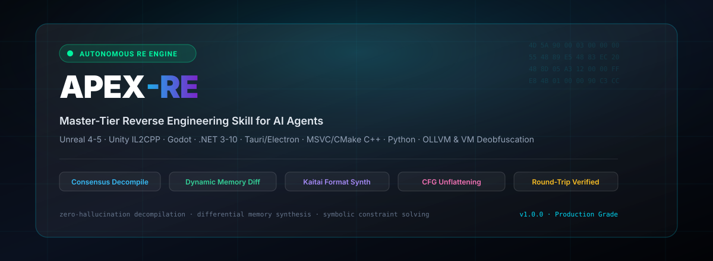
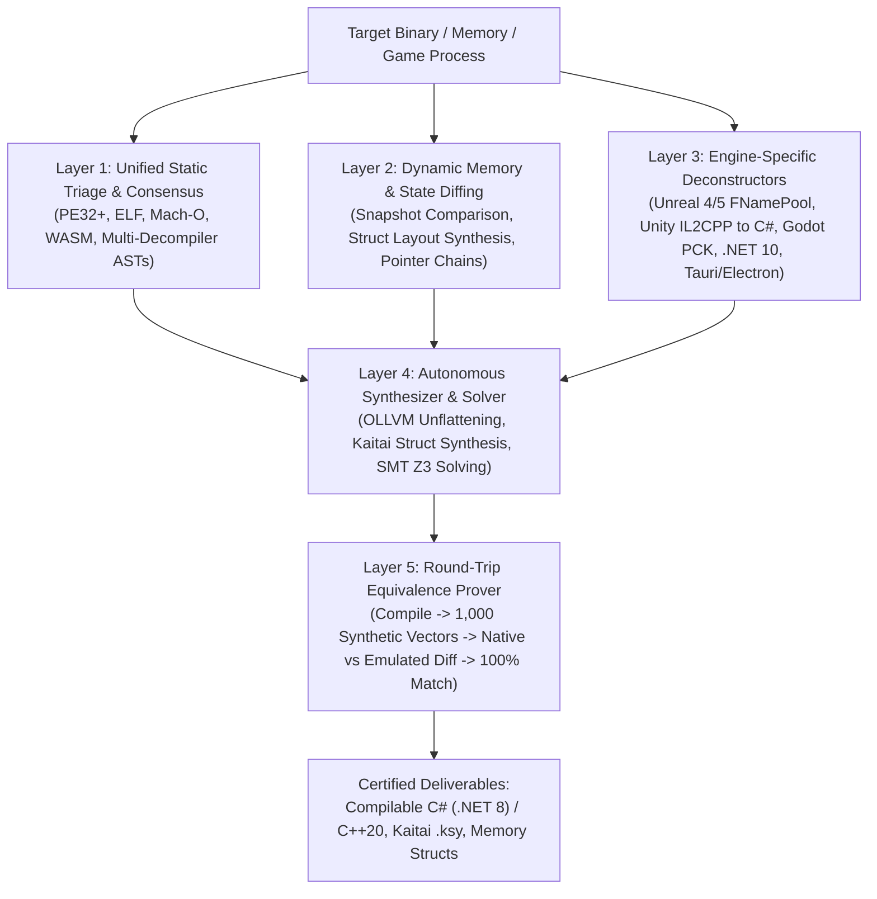

<p align="center">
  
</p>

#  Apex-RE: Master-Tier Reverse Engineering Skill for AI Agents

**Autonomous Binary Analysis, Consensus Decompilation, Dynamic Memory Diffing, and Control Flow Unflattening for AI Coding Agents.**

[](https://github.com/emrewyt/apex-re/stargazers)
[](LICENSE)
[](.github/workflows/ci.yml)


>  **Star this repository** to support autonomous, zero-hallucination reverse engineering for AI coding agents!

---

##  Overview

Most reverse engineering skills for AI agents suffer from critical limitations:
1. **Static Blindness:** They inspect static decompilation text without understanding live memory layout or dynamic state mutations.
2. **Obfuscation Paralysis:** Control Flow Flattening (OLLVM), opaque predicates, and bytecode dispatchers force models into speculative guesswork.
3. **Engine-Specific Gaps:** They lack deep heuristics for Unreal Engine reflection (`FNamePool`, `GUObjectArray`), Unity IL2CPP solution reconstruction, Godot PCK packaging, and .NET NativeAOT method tables.
4. **No Verification Loop:** They cannot mathematically prove that reconstructed C# or C++ code behaves identically to the original binary.

**Apex-RE** provides a five-layer operational methodology that equips AI agents with the diagnostic workflow of an expert reverse engineer:



---

##  1-Line Installation

Apex-RE integrates with **Antigravity 2.0**, **Claude Code**, **Codex**, **Cursor**, and **Gemini CLI**.

### Windows (PowerShell)
```powershell
irm https://raw.githubusercontent.com/emrewyt/apex-re/main/install.ps1 | iex
```

Or from local clone:
```powershell
.\install.ps1 -Target all -Scope user
```

### Linux & macOS (Bash)
```bash
curl -fsSL https://raw.githubusercontent.com/emrewyt/apex-re/main/install.sh | bash
```

Or from local clone:
```bash
./install.sh --target all --scope user
```

---

##  Bundled Analysis Utilities

The `skills/apex-re/scripts/` directory contains four zero-dependency Python tools:

| Utility | Purpose | Capabilities |
| :--- | :--- | :--- |
| **`apex_triage.py`** | Deep Binary Triager | Parses PE32/PE32+, ELF, Mach-O, WASM. Calculates section Shannon entropy, identifies W+X anomalies, detects packers (UPX, VMProtect, Themida), and fingerprints engines (Unreal, Unity, Godot, .NET NativeAOT, Electron, Tauri, Python). |
| **`memory_diff.py`** | Memory State Differ | Compares two binary memory dumps (before/after action), isolates variable mutations (int8..int64, float32, float64, pointer), and synthesizes compilable C++ and C# explicit struct definitions. |
| **`kaitai_synth.py`** | Kaitai Format Synthesizer | Analyzes binary structures, packets, or save games. Identifies headers, endianness, primitive sequences, and emits valid Kaitai Struct (`.ksy`) YAML specifications. |
| **`unflatten_trace.py`**| Control Flow Unflattener | Deobfuscates OLLVM state-dispatcher loops. Eliminates the artificial switch machine and reconstructs clean linear C control flow or Mermaid diagrams. |

### CLI Usage Examples

#### Deep Binary Triage
```bash
python skills/apex-re/scripts/apex_triage.py GameAssembly.dll
```
```text
========================================================================
 APEX-RE TRIAGE REPORT : GameAssembly.dll
========================================================================
  Format        : PE32+ (64-bit)
  Architecture  : x64 (AMD64 / 64-bit)
  File Size     : 48,234,496 bytes
  Total Entropy : 6.4210 / 8.0000
  Entry Point   : 0x140001000
  Game Engine   : Unity (IL2CPP)
  Runtimes      : Unity IL2CPP AOT, MSVC C/C++ Runtime
  Protections   : None Detected
------------------------------------------------------------------------
```

#### Differential Memory Struct Synthesis
```bash
python skills/apex-re/scripts/memory_diff.py before.bin after.bin --align 4 --struct PlayerEntity
```
```cpp
// Auto-generated by Apex-RE Memory Synthesizer
#include <cstdint>

struct PlayerEntity {
    uint8_t _pad_00[0x24];       // 0x0000 -> 0x0024
    int32_t Health;              // changed: 100 -> 85 (delta: -15)
    uint8_t _pad_01[0x04];
    float   MoveSpeed;           // changed: 1.0000f -> 1.5000f
    uintptr_t InventoryPointer;  // ptr: 0x00007FF720000000
};
```

---

##  Master Technical References

Comprehensive documentation included in `skills/apex-re/references/`:

| Guide | Description |
| :--- | :--- |
| [`game-engines-unreal-unity.md`](skills/apex-re/references/game-engines-unreal-unity.md) | Unreal Engine 4/5 FNamePool, GUObjectArray, ProcessEvent hooking, Unity Mono & IL2CPP solution reconstruction. |
| [`godot-engine.md`](skills/apex-re/references/godot-engine.md) | Godot 3/4 `.pck` structure, GDScript bytecode disassembly, AES decryption, GDExtension C++ bindings. |
| [`dotnet-and-nativeaot.md`](skills/apex-re/references/dotnet-and-nativeaot.md) | .NET 3.5 to 10, single-file bundle extraction, ReadyToRun (R2R) native code, and NativeAOT EEType recovery. |
| [`desktop-electron-tauri.md`](skills/apex-re/references/desktop-electron-tauri.md) | Electron ASAR extraction, IPC channel tracing, Tauri Rust command routing, and embedded web asset carving. |
| [`msvc-cmake-native.md`](skills/apex-re/references/msvc-cmake-native.md) | PE/ELF conventions, MSVC C++ RTTI (`CompleteObjectLocator`), vtable reconstruction, and STL memory layouts. |
| [`python-bytecodes.md`](skills/apex-re/references/python-bytecodes.md) | PyInstaller extraction, `.pyc` magic restoration, `pycdc` decompilation, and PyArmor frame hooking. |
| [`obfuscation-and-virtual-machines.md`](skills/apex-re/references/obfuscation-and-virtual-machines.md) | OLLVM unflattening, opaque predicate solving with Z3, and VM devirtualization (VMProtect/Themida). |
| [`dynamic-memory-diffing.md`](skills/apex-re/references/dynamic-memory-diffing.md) | Memory snapshot diffing, multi-level pointer chains, and Frida runtime instrumentation. |
| [`symbolic-and-emulation.md`](skills/apex-re/references/symbolic-and-emulation.md) | Unicorn CPU emulation, Qiling OS emulation, angr path exploration, and Z3 constraint solving. |
| [`decompilation-consensus.md`](skills/apex-re/references/decompilation-consensus.md) | Reconciling Ghidra, IDA Pro, Binary Ninja, and ILSpy outputs while preventing LLM context starvation. |
| [`pseudocode-to-raw-code.md`](skills/apex-re/references/pseudocode-to-raw-code.md) | Transforming raw pseudocode into production-ready, compilable C# (.NET 8), modern C++20, and Python. |
| [`verification-loop.md`](skills/apex-re/references/verification-loop.md) | Differential testing with 1,000 synthetic test vectors under Unicorn to certify 100% equivalence. |

---

##  Agent Prompts Library

Looking for ready-to-paste prompts for your AI agents? Check out [`PROMPTS.md`](PROMPTS.md) for 8 curated prompt templates in both English and Turkish covering:
- Unreal Engine 5 Actor Tracing
- Unity IL2CPP Solution Recovery
- .NET 8 NativeAOT Deconstruction
- OLLVM Control Flow Unflattening
- Proprietary Format to Kaitai Struct
- Memory Snapshot State Diffing
- Multi-Engine Consensus Decompilation
- Round-Trip Equivalence Verification

---

##  License & Maintainer

Apex-RE is distributed under the **MIT License**. Maintained by **Emre** ([FLUVEA](https://github.com/emrewyt)).
