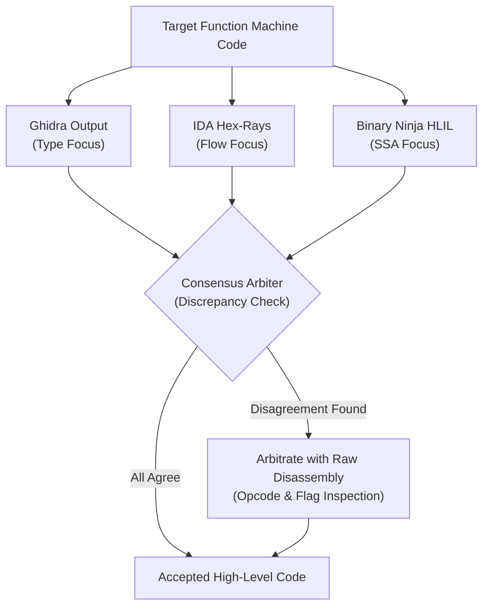

# Multi-Engine Decompilation Consensus & Token-Efficient ASTs

Methodology for cross-validating decompilation outputs across Ghidra, IDA Pro, Binary Ninja, and ILSpy while preventing LLM context window starvation.

---

## 1. Why Single Decompilers Fail

No decompiler is universally correct. Each engine uses different intermediate representations and optimization passes:

```text
Engine Comparison
├── IDA Pro (Hex-Rays)     -> Best control flow recovery, but may over-optimize volatile pointer accesses
├── Ghidra (GhidraDecomp)  -> Strong type propagation, but produces verbose cast expressions and inverted branches
├── Binary Ninja (MLIL/HLIL)-> Exceptional SSA form and variable lifetime analysis, but occasionally struggles with complex C++ templates
└── ILSpy (ICSharpCode)     -> Unmatched C# language reconstructor, but limited to managed .NET IL
```

### The Consensus Principle
When analyzing mission-critical algorithms (crypto routines, network decoders, anti-cheat checks), an AI agent must cross-validate discrepancies using the consensus rule:



---

## 2. Resolving Common Decompiler Discrepancies

### 2.1 Loop Bound Discrepancies (`<` vs `<=`)
- **Symptom:** Ghidra emits `for (i = 0; i < count; i++)`, while IDA emits `for (i = 0; i <= count - 1; i++)`.
- **Arbitration Rule:** Inspect the conditional jump opcode in raw assembly:
  - `jl` / `jb` (Jump Less / Below): Strict inequality (`<`).
  - `jle` / `jbe` (Jump Less or Equal / Below or Equal): Inclusive inequality (`<=`).

### 2.2 Sign Extension vs Zero Extension
- **Symptom:** One decompiler treats an integer variable as signed (`int32_t`), another as unsigned (`uint32_t`).
- **Arbitration Rule:** Check the extension instruction:
  - `movsx` / `movsxd` / `cdqe`: Signed arithmetic.
  - `movzx` / zeroed 32-bit register write (`mov eax, ecx` clears top 32 bits): Unsigned arithmetic.

---

## 3. Preventing AI Agent Context Starvation

Raw decompiled dumps of large functions waste valuable context tokens on boilerplate setup, stack canaries, and standard prologues/epilogues.

### Two-Stage Hierarchical Representation

#### Stage 1: Abstract Function Interface (Summary Stage)
Before reading full function bodies, query only the structural summary:
```yaml
function_summary:
  address: "0x140024B10"
  symbol: "VerifyAuthenticationToken"
  calling_convention: "__fastcall"
  parameters:
    - name: "token_ptr"
      type: "const uint8_t*"
      register: "RCX"
    - name: "token_len"
      type: "uint32_t"
      register: "RDX"
  returns: "bool (RAX)"
  callees:
    - "0x140050120 (Crypto::SHA256)"
    - "0x140051890 (Memory::Compare)"
  complexity:
    basic_blocks: 14
    cyclomatic: 6
  critical_blocks:
    - id: "BB_04"
      purpose: "XOR decryption loop"
    - id: "BB_09"
      purpose: "Signature verification branch"
```

#### Stage 2: Selective Core Block Expansion
Only request the raw decompiled pseudocode of the specific algorithmic block identified in Stage 1:
```text
/expand-block 0x140024B10:BB_04
```
This reduces token consumption by over 85% while delivering 100% precision for the algorithmic core.
