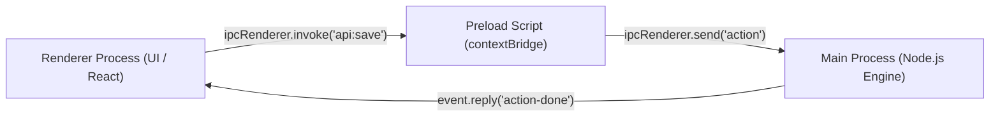

# Desktop Applications: Electron & Tauri Reverse Engineering

Technical reference for deconstructing desktop web-runtime applications built with Electron (Chromium + Node.js) and Tauri (Rust + OS WebView).

---

## 1. Electron Applications

```text
Electron Application Directory
├── app.asar / resources/app.asar  -> Packed JavaScript/TypeScript archive
├── electron.exe / App.exe         -> Chromium + Node.js binary wrapper
└── node.dll / ffmpeg.dll          -> Embedded runtime libraries
```

### 1.1 Unpacking ASAR Archives
ASAR is an archive format with a JSON-encoded header describing directory layouts and offsets:
```bash
# Using official asar CLI
npx @electron/asar extract resources/app.asar ./unpacked_source
```
If `@electron/asar` is unavailable, use standard Python:
- The first 16 bytes contain:
  - 4-byte uint32 header size prefix
  - 4-byte uint32 header data length
  - 4-byte uint32 JSON string length
- Followed by the UTF-8 JSON header listing file offsets and sizes inside the file payload.

### 1.2 IPC Channel Reconstruction
To understand the application logic, trace the bidirectional IPC boundaries:



1. **Preload Boundary:** Check `contextBridge.exposeInMainWorld("api", { ... })`.
2. **Main Handlers:** Search for `ipcMain.handle("channel", async (event, args) => { ... })` and `ipcMain.on("channel", ...)`.
3. **Native Modules:** Check for `.node` files in `node_modules/`. These are compiled C/C++ PE DLLs exporting `napi_register_module_v1` or `node_module_register`.

### 1.3 Bytenode & V8 Bytecode (`.jsc`)
If JavaScript files are replaced with compiled V8 bytecode (e.g. `index.jsc`):
- Bytecode files are tied to the exact V8 / Node.js version compiled in `node.dll`.
- Use `node-bytenode` matching the target's exact Node version to disassemble or inspect the bytecode AST.

---

## 2. Tauri Applications (Rust + WebView)

Tauri applications compile native Rust code with an embedded OS WebView (WebView2 on Windows, WebKitGTK on Linux).

```text
Tauri Binary Structure
├── Rust Core Binary              -> Business logic, IPC handlers, filesystem/crypto calls
├── Embedded Assets (Compressed)  -> Bundled Vite/React/HTML frontend assets in .rdata
└── OS WebView Wrapper            -> Lightweight host container
```

### 2.1 Extracting Embedded Web Assets
In Tauri production builds, web assets are embedded into the native binary via Rust's `include_dir!` macro or compressed TAR/ZIP chunks.
1. Search the `.rdata` section for common frontend strings:
   - `"<!DOCTYPE html>"`
   - `"/assets/index-"`
   - `"__TAURI__"`
2. If assets are GZIP/Brotli compressed, extract the payload with binwalk or custom string carve.

### 2.2 Reconstructing Tauri IPC Commands
In the frontend, Tauri invokes backend Rust functions with:
```javascript
import { invoke } from '@tauri-apps/api/tauri';
await invoke('perform_cryptographic_verification', { token: "abc" });
```

In the compiled Rust backend:
- Each command is registered through the `generate_handler![...]` macro.
- In Ghidra/IDA, search for strings matching the command name (e.g. `"perform_cryptographic_verification"`).
- Cross-reference to find the command dispatcher function:
  ```rust
  // Demangled Rust signature:
  app::commands::perform_cryptographic_verification::{{closure}}
  ```
- Command handlers take serialized JSON or MessagePack arguments and return `Result<T, E>`.

### 2.3 Demangling Rust Symbols
Use `rustfilt` to clean complex mangled symbols:
```bash
# Mangled symbol:
_ZN4core3ops8function6FnOnce9call_once17h62b6d19488a0e8d3E
# Demangled:
core::ops::function::FnOnce::call_once
```
