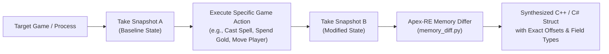

# Dynamic Memory Diffing & Differential State Analysis

Technical guide for extracting data structures, field offsets, and pointer chains through runtime memory snapshots and differential state analysis.

---

## 1. The Power of Differential State Analysis

Static analysis often requires hours to trace complex object graphs. Differential state analysis solves this by comparing physical memory snapshots taken immediately before and after a specific action:

```text
Snapshot A (Before Action)         Snapshot B (After Action)
Player HP = 100                    Player HP = 85 (Action: Took 15 damage)
Offset 0x0024 = 0x00000064        Offset 0x0024 = 0x00000055  <-- DELTA DETECTED: -15
```

---

## 2. Memory Snapshotting Workflow



### 2.1 Using `memory_diff.py`
Run the bundled differ to identify all modified offsets and automatically synthesize C++ and C# structs:

```bash
python memory_diff.py dump_before.bin dump_after.bin --base 0x140000000 --align 4 --struct PlayerEntity
```

Generated Output:
```cpp
// C++ Struct
struct PlayerEntity {
    uint8_t _pad_00[0x24];       // 0x0000 -> 0x0024
    int32_t Health;              // changed: 100 -> 85 (delta: -15)
    uint8_t _pad_01[0x04];
    float   MoveSpeed;           // changed: 1.0f -> 1.5f
    uintptr_t InventoryPointer;  // ptr: 0x00007FF720000000
};
```

---

## 3. Resolving Multi-Level Pointer Chains

Modern engines allocate entities dynamically on the heap; virtual addresses change on every game launch. To access state reliably, resolve the pointer chain back to a static module root:

```text
GameAssembly.dll + 0x02B41800 (Static Module Base)
  └── ReadPointer() -> Address A
        └── Offset + 0x58 -> ReadPointer() -> Address B (GameManager)
              └── Offset + 0x20 -> ReadPointer() -> Address C (ActivePlayer)
                    └── Offset + 0x1A0 -> Health (Value)
```

### Pointer Resolution in C# (.NET 8):
```csharp
public static unsafe int GetPlayerHealth(nint moduleBase, int[] offsets)
{
    nint current = moduleBase;
    for (int i = 0; i < offsets.Length - 1; i++)
    {
        current = *(nint*)(current + offsets[i]);
        if (current == 0) return -1; // Null pointer check
    }
    return *(int*)(current + offsets[^1]);
}
```

---

## 4. Frida Runtime Memory Instrumentation

Use Frida to hook instruction reads/writes and log data mutations in real time:

```javascript
// Monitor writes to a discovered struct offset
const targetAddress = ptr("0x7FF720050024");

MemoryAccessMonitor.enable({
    base: targetAddress,
    size: 4
}, {
    onAccess: function (details) {
        console.log("[Memory Write Detected]");
        console.log("  Operation : " + details.operation);
        console.log("  Caller IP : " + details.from);
        console.log("  Address   : " + details.address);
    }
});
```
