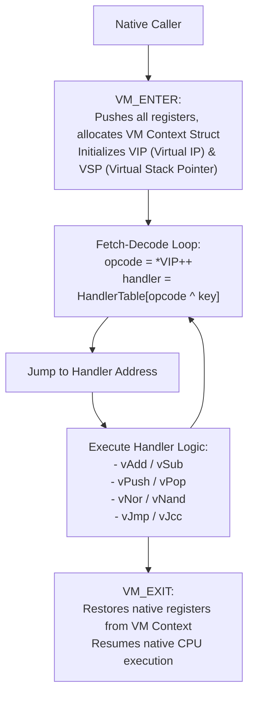

# Obfuscation & Virtual Machine Protectors: Deconstruction & Devirtualization

Master-tier reference guide for deobfuscating Control Flow Flattening (OLLVM), defeating Opaque Predicates, and devirtualizing VM-based protectors (VMProtect, Themida, Code Virtualizer, and Custom Bytecode VMs).

---

## 1. Control Flow Flattening (CFF / OLLVM)

Control Flow Flattening destroys natural programming constructs (`if`, `else`, `while`, `for`) by breaking a function into isolated basic blocks governed by an artificial central dispatcher switch statement.

```text
Original Control Flow:
[Block A] ──> [Block B] ──> [Block C]

Flattened Control Flow (OLLVM):
                  ┌──────────────────────┐
                  │ Central Dispatcher   │ ◄──────────┐
                  │ (switch (state_var)) │            │
                  └──────────┬───────────┘            │
         ┌───────────────────┼───────────────────┐    │
         ▼                   ▼                   ▼    │
  [Case 0x1A: Block A] [Case 0x2B: Block B] [Case 0x3C: Block C]
  state = 0x2B        state = 0x3C        state = EXIT
         └───────────────────┴───────────────────┴────┘
```

### 1.1 Automated Unflattening Workflow

1. **Dispatcher Identification:**
   Locate the basic block with the highest in-degree (the switch loop head) and identify the state variable register/stack slot (e.g. `DWORD PTR [rbp-0x10]`).
2. **Handler Extraction:**
   For each case of the switch, extract:
   - Case condition value (`state == 0x1A`)
   - Target basic block address
   - State transition formula (`next_state = 0x2B` or `next_state = (cond) ? 0x2B : 0x4F`)
3. **Control Flow Graph Reconstruction:**
   - Remove the dispatcher block entirely.
   - Patch the terminator of each basic block to jump directly to its true successor block:
     ```asm
     ; Obfuscated:
     mov dword ptr [rbp-0x10], 0x2B
     jmp dispatcher_head

     ; Deobfuscated Patch:
     jmp block_B
     ```
4. **Tooling:**
   Use the bundled `unflatten_trace.py` script to generate a clean C structural control flow from execution traces.

---

## 2. Opaque Predicates

An opaque predicate is a conditional statement whose outcome is mathematically fixed (always True or always False) at compile time, but whose invariance is difficult for static decompilers to determine.

### 2.1 Mathematical Patterns

| Pattern | Mathematical Invariant | Deobfuscation Action |
| :--- | :--- | :--- |
| `(x * (x + 1)) % 2 == 0` | Product of two consecutive integers is always even (True). | Eliminate False branch and dead code block. |
| `(x * x) >= 0` | Square of any signed integer is non-negative (True, assuming no overflow). | Replace branch with unconditional jump. |
| `7 * y * y - 1 == x * x` | Has no integer solutions (False). | Delete unreachable code. |

### 2.2 Symbolic Proving via Z3 / angr
When an opaque predicate depends on complex algebraic expressions, solve it symbolically with Z3:

```python
from z3 import *

x = BitVec('x', 32)
# Check if predicate can ever evaluate to False:
solver = Solver()
predicate = ((x * (x + 1)) % 2) == 0
solver.add(Not(predicate))

if solver.check() == unsat:
    print("[+] Proved mathematically: Branch is invariant (Always True). Dead code eliminated.")
```

---

## 3. Virtual Machine (VM) Protectors: Devirtualization

Protectors like VMProtect, Themida, and proprietary game anti-cheats convert native x86/x64 instructions into proprietary, encrypted bytecode interpreted by an embedded virtual machine.

### 3.1 Anatomy of a Bytecode Virtual Machine



### 3.2 The 5-Step Devirtualization Methodology

#### Step 1: Trace the VM Execution
Run the virtualized routine under a deterministic emulator (Unicorn Engine or Qiling Framework) or instrument it with Frida. Record every basic block executed.

#### Step 2: Identify the VM Context & Registers
- Locate the pointer to the VM context structure (commonly stored in `RBP` or `R14`).
- Identify the memory slots corresponding to virtual registers (`VReg0` = `EAX`, `VReg1` = `EBX`, etc.).

#### Step 3: Extract and Symbolize Handlers
Most VMs only implement 10-20 core operations disguised through heavy polymorphism:
- Arithmetic: `vADD`, `vSUB`, `vMUL`
- Logic: `vNOR` (used to synthesize `AND`, `OR`, `NOT`, `XOR`)
- Stack: `vPUSH_IMM`, `vPUSH_REG`, `vPOP_REG`
- Memory: `vREAD_MEM`, `vWRITE_MEM`
- Control Flow: `vJMP`, `vJCC` (conditional branch)

#### Step 4: De-virtualize Bytecode into LLVM IR
Convert each decoded virtual instruction into a clean LLVM IR instruction:
- `vPUSH_REG VReg0` $\to$ `%0 = load i32, i32* %eax`
- `vADD VReg1` $\to$ `%1 = add i32 %0, %ebx`
- `vPOP_REG VReg0` $\to$ `store i32 %1, i32* %eax`

#### Step 5: Native Recompilation
Feed the recovered LLVM IR into `clang -O3` to compile a clean, native, 100% deobfuscated binary without a trace of the virtual machine.
