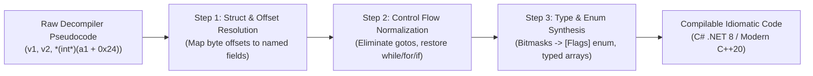

# Transforming Decompiled Pseudocode into Production-Ready Raw Code

Comprehensive guide for transforming raw, uncompilable decompiler pseudocode (`v1`, `uVar2`, `*(int*)(a1 + 0x28)`) into clean, idiomatic, compilable C# (.NET 8), modern C++20, and Python.

---

## 1. The Transformation Pipeline

Decompiler output is designed for human inspection, not compilation. It suffers from:
- Machine artifacts: Artificial temporary variables (`v1`, `v2`, `uVar3`), raw pointer casts, stack alignment arithmetic.
- Mangled control flow: `goto` spaghetti and fake boolean flags.
- Missing abstractions: Structs flattened into arbitrary byte offsets.



---

## 2. Step-by-Step Reconstruction Rules

### Rule 1: Replace Pointer Arithmetic with Struct Fields
- **Pseudocode:**
  ```c
  *(int *)(a1 + 0x24) = *(int *)(a1 + 0x24) - a2;
  if (*(int *)(a1 + 0x24) <= 0) {
      *(char *)(a1 + 0x40) = 1;
  }
  ```
- **Transformed C# (.NET 8):**
  ```csharp
  public class Character
  {
      public int Health { get; set; }
      public bool IsDead { get; set; }

      public void ApplyDamage(int damage)
      {
          Health -= damage;
          if (Health <= 0)
          {
              IsDead = true;
          }
      }
  }
  ```

### Rule 2: Unroll / Structuralize Loop Constructs
- **Pseudocode:**
  ```c
  i = 0;
  LABEL_5:
  if (i >= *(unsigned int *)(buf + 4)) goto LABEL_10;
  checksum = (checksum ^ buf[i + 8]) * 16777619;
  i++;
  goto LABEL_5;
  LABEL_10:
  ```
- **Transformed C++20:**
  ```cpp
  uint32_t CalculateFNV1a(std::span<const uint8_t> buffer) {
      uint32_t checksum = 0x811C9DC5;
      for (uint8_t byte : buffer) {
          checksum = (checksum ^ byte) * 16777619u;
      }
      return checksum;
  }
  ```

### Rule 3: Synthesize Bitfield Flags into Enums
- **Pseudocode:**
  ```c
  if ((flags & 0x01) != 0) { ... }
  if ((flags & 0x04) != 0) { ... }
  ```
- **Transformed C# (.NET 8):**
  ```csharp
  [Flags]
  public enum EntityFlags : uint
  {
      None        = 0,
      IsInvulnerable = 1 << 0, // 0x01
      IsFlying       = 1 << 1, // 0x02
      HasShield      = 1 << 2, // 0x04
  }
  ```

---

## 3. High-Performance C# (.NET 8) Memory Reconstruction

When reconstructing network packet deserializers or file readers, use modern .NET 8 zero-allocation memory primitives (`Span<T>`, `ReadOnlySpan<T>`, `BinaryPrimitives`):

```csharp
using System;
using System.Buffers.Binary;

public static class PacketDeserializer
{
    public static (int PacketId, float Speed, string Tag) ParseHeader(ReadOnlySpan<byte> packet)
    {
        // Zero memory allocation slice parsing
        int packetId = BinaryPrimitives.ReadInt32LittleEndian(packet[0..4]);
        float speed = BinaryPrimitives.ReadSingleLittleEndian(packet[4..8]);
        
        int tagLen = BinaryPrimitives.ReadInt16LittleEndian(packet[8..10]);
        string tag = System.Text.Encoding.UTF8.GetString(packet.Slice(10, tagLen));

        return (packetId, speed, tag);
    }
}
```
