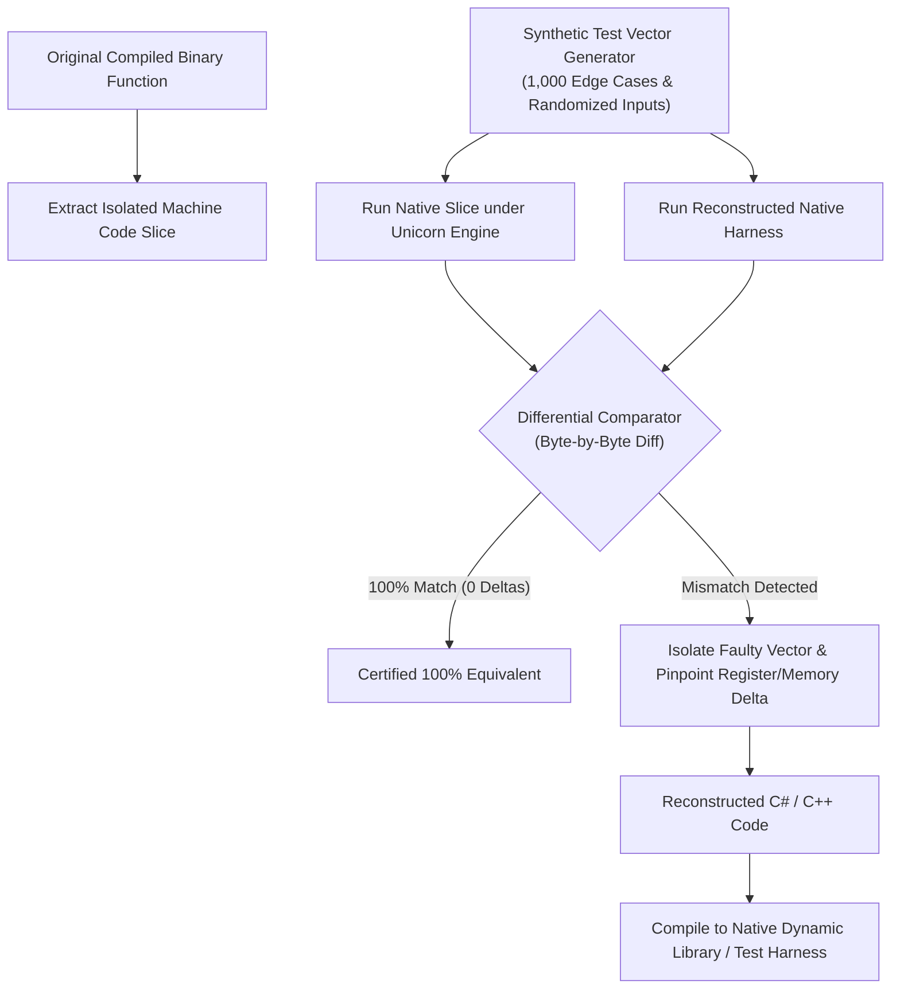

# Round-Trip Verification & Equivalence Prover

Methodology for mathematically verifying that reconstructed high-level code behaves with 100% functional equivalence to the original compiled binary.

---

## 1. The Verification Imperative

When an AI agent reverse engineers complex logic (cryptographic ciphers, hashing, physics equations, packet decoders), subtle hallucination bugs (such as operator precedence, sign extension, off-by-one errors) can occur.

The **Round-Trip Verification Loop** eliminates guesswork by executing both the original binary slice and the reconstructed code under an identical harness with automated differential testing:



---

## 2. Test Vector Generation Principles

A robust verification harness requires diverse test vectors:

1. **Boundary & Edge Values:**
   - Integers: `0`, `1`, `-1`, `0x7FFFFFFF` (`INT32_MAX`), `0x80000000` (`INT32_MIN`), `0xFFFFFFFF` (`UINT32_MAX`).
   - Floats: `0.0f`, `-0.0f`, `1.0f`, `1e-6f`, `NaN`, `+Infinity`, `-Infinity`.
   - Buffers: Empty buffer (`len = 0`), single-byte, misaligned buffers (offset by 1, 3, 5 bytes).
2. **Random Uniform Fuzz Vectors:**
   - 1,000 pseudo-random byte buffers generated with fixed seeds for deterministic reproducibility.

---

## 3. Python Verification Harness Blueprint

Below is an automated verification script blueprint comparing an original machine code slice with a reconstructed C implementation compiled via `ctypes`:

```python
import ctypes
import random
from unicorn import *
from unicorn.x86_const import *

# 1. Load compiled reconstructed function
reconstructed_lib = ctypes.CDLL("./reconstructed_code.so")
reconstructed_func = reconstructed_lib.reconstructed_algo
reconstructed_func.argtypes = [ctypes.c_uint32, ctypes.c_uint32]
reconstructed_func.restype = ctypes.c_uint32

# 2. Setup Unicorn emulator for the original native slice
ORIGINAL_CODE = bytes.fromhex("89F80FAF44240431D0C3") # native: imul eax, edx; xor eax, edx; ret
BASE_ADDR = 0x140000000
STACK_ADDR = 0x7FFF0000

def run_native_slice(val_a: int, val_b: int) -> int:
    mu = Uc(UC_ARCH_X86, UC_MODE_64)
    mu.mem_map(BASE_ADDR, 4096)
    mu.mem_map(STACK_ADDR, 4096)
    mu.mem_write(BASE_ADDR, ORIGINAL_CODE)
    mu.reg_write(UC_X86_REG_RSP, STACK_ADDR + 2048)

    # Set parameters in registers (System V AMD64: RDI, RSI)
    mu.reg_write(UC_X86_REG_RDI, val_a)
    mu.reg_write(UC_X86_REG_RSI, val_b)

    mu.emu_start(BASE_ADDR, BASE_ADDR + len(ORIGINAL_CODE))
    return mu.reg_read(UC_X86_REG_RAX) & 0xFFFFFFFF

# 3. Execute 1,000 differential test vectors
print("[*] Running 1,000 differential test vectors...")
for i in range(1000):
    val_a = random.randint(0, 0xFFFFFFFF)
    val_b = random.randint(0, 0xFFFFFFFF)

    expected = run_native_slice(val_a, val_b)
    actual = reconstructed_func(val_a, val_b)

    if expected != actual:
        raise AssertionError(f"[!] Equivalence Failure at vector {i}: args=({val_a}, {val_b}), expected=0x{expected:X}, actual=0x{actual:X}")

print("[+] Verification Succeeded: 1,000/1,000 test vectors matched with zero deltas.")
```
